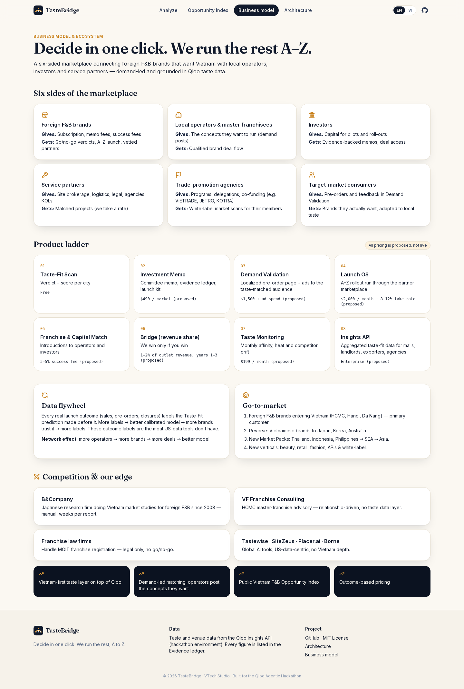
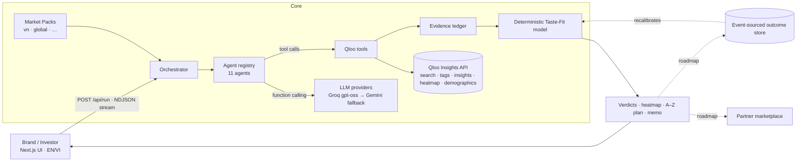

<div align="center">

# TasteBridge

**Should your F&B brand enter Vietnam? Decide in one click. We run the rest, A–Z.**

A multi-agent go / no-go investment advisor for restaurant and beverage brands crossing borders, powered by the **Qloo Taste AI™ Insights API**.

[Live demo](#live-demo) · [How it works](#how-it-works) · [Architecture](#architecture) · [Business model](#business-model) · [Business architecture (EN)](docs/BUSINESS_ARCHITECTURE.md) · [(VI)](docs/BUSINESS_ARCHITECTURE.vi.md)

   


</div>

---

## The problem

A foreign F&B brand looking at Vietnam today hires a consultancy for weeks of manual research, then a franchise lawyer, a site broker and an agency — and still has to guess whether Vietnamese diners in Ho Chi Minh City, Hanoi or Da Nang share its taste. The founder only wants three answers: **should I put money in, where, and how much risk am I taking?**

## What TasteBridge does

Type a brand (or pick a real brand that is not yet in Vietnam). Eleven AI agents go into Qloo's cultural taste graph and come back with:

- **A verdict per city — GO / PILOT / NO-GO** — with a transparent **Taste-Fit Score (0–100)** and a confidence level.
- **The evidence**: taste-matched local venues, category analogs and saturation, a **neighborhood heatmap**, audience age/gender skew, and cross-domain tastes (music, TV, brands) — every number traceable to a Qloo API request in the **evidence ledger**.
- **An investment committee**: a bull agent and a bear agent argue; a chair agent rules, lists the top 3 risks and the first move. A **phase-1 budget band** is expressed as a share of *your own* budget.
- **The A–Z launch kit** after a GO / PILOT: best neighborhood, localized menu and positioning, KOL and collab picks, a 90-day rollout and a taste-monitoring loop.
- **"Test before you invest"**: a Vietnamese pre-order landing page and ad variants aimed at the taste-matched audience.
- **Partner match**: prioritized local partner roles (master franchisee, site broker, franchise legal, cold chain, KOL agency, delivery) with must-haves and red flags.
- **A one-page investor memo** (print / save as PDF) and a **scenario ROI calculator** (USD or VND) that only uses the founder's own assumptions.
- **Vietnam F&B Opportunity Index**: a public ranking of foreign brands not yet in Vietnam by their best Taste-Fit Score.

Primary direction: **foreign brand → Vietnam**. Secondary: **Vietnamese brand → abroad** (Tokyo, Seoul, Sydney, LA, Singapore, Bangkok). UI is bilingual (English default, Vietnamese toggle).

## Live demo

- **App:** _LIVE_URL_
- **Try:** Analyze → pick **Blue Bottle Coffee** → add a budget → *Run the agent committee*. A full run takes about a minute.

| Live agent timeline | Result board, heatmap, A–Z plan |
|---|---|
|  |  |

| Opportunity Index | Business model | Mobile |
|---|---|---|
|  |  |  |

Sample investor memo: [docs/screenshots/investor-memo.pdf](docs/screenshots/investor-memo.pdf)

## How it works

| # | Agent | Qloo tools it calls (native function calling) | Output |
|---|---|---|---|
| 1 | **Brand Profiler** | `/search` (places), `/v2/tags`, `urn:demographics` | Anchor venues, taste tags, category tag, audience skew |
| 2 | **Market Scout** | `/v2/insights` `filter.type=urn:entity:place` + `filter.location.query`, `urn:heatmap` | Taste-matched F&B venues and neighborhood heat per city |
| 3 | **Analog Hunter** | `/v2/insights` with `filter.tags` (retries with a better tag if a city returns 0) | Category analogs, popularity, saturation |
| 4 | **Culture Mapper** | `/v2/insights` `urn:entity:artist / tv_show / brand` + `signal.location.query` | Marketing angles, collabs, KOL profiles |
| 5 | **Localization Chef** | local taste profile (aggregated menu highlights + Qloo price levels) | Menu tweaks, positioning, price tier |
| 6–8 | **Bull · Bear · Chair** | evidence digest | Arguments, rationale, top 3 risks, first move, recommendation |
| 9 | **A–Z Launch Planner** | evidence digest | Neighborhood, format, marketing, KOLs, 90-day timeline, monitoring |
| 10 | **Demand Validator** | evidence digest | Vietnamese landing page + ad variants |
| 11 | **Partner Matchmaker** | market pack partner roles | Prioritized partner briefs |

### The Taste-Fit Score (deterministic — the LLM never produces numbers)

```
audienceFit = mean Qloo affinity of F&B venues in the city whose audience overlaps the brand
demandProof = 0.5 × min(1, analogs / 30) + 0.5 × mean Qloo popularity of category analogs
whitespace  = 1 − share of analogs with popularity ≥ 0.9
score       = 100 × (0.5·audienceFit + 0.3·demandProof + 0.2·whitespace)
GO ≥ 70 · PILOT ≥ 55 · NO-GO < 55 · low confidence can never be a full GO
```
Budget bands: GO 50–80%, PILOT 15–30%, NO-GO 0–5% **of the budget the founder enters**. TasteBridge never invents market costs or revenues.

## Architecture



- **Agentic tool use:** each agent is an LLM loop with its own JSON-schema tools. If an agent skips a city, the orchestrator runs that tool directly and labels it `auto` in the timeline, so a run never silently loses data.
- **Coverage gate:** per-city agents must answer for every city; missing ones trigger one corrective retry.
- **Streaming:** the server streams NDJSON events (agent start, tool call, tool result, outputs) to drive the animated timeline.
- **Market Packs** (`src/lib/markets/packs`): a new country = cities + Qloo query strings + locale/currency + partner roles + regulatory notes. No code fork.
- **Privacy & terms:** the Qloo key lives only in server env vars; Qloo responses are cached in memory only and never committed.

Stack: Next.js 15 (App Router) · TypeScript strict · Tailwind CSS v4 design tokens · Framer Motion · React-Leaflet · Zod · Vitest · GitHub Actions CI.

## Qloo coverage in Vietnam (audited 2026-10-14)

Using Blue Bottle Coffee as the signal (`take=20`):

| City | Similar places | Mean affinity | Heatmap cells | Tier |
|---|---|---|---|---|
| Ho Chi Minh City | 20 | 0.641 | 39 | deep |
| Hanoi | 20 | 0.668 | 28 | deep |
| Da Nang | 20 | 0.683 | 29 | deep |
| Hoi An | 20 | 0.675 | 25 | medium |
| Nha Trang | 20 | 0.640 | 7 | thin |
| Hai Phong | 20 | 0.634 | 2 | thin |
| Can Tho | 20 | 0.612 | 2 | thin |
| Da Lat | 20 | 0.636 | 1 | thin |

**Limits, stated honestly:** neighborhood-level heatmaps are meaningful for HCMC, Hanoi, Da Nang and Hoi An; thin elsewhere. Place results include hotels, so we keep only venues carrying a cuisine / menu tag. Analog queries are capped at 50 results. Demographics are brand-level (not city-level). Some tag ids (e.g. `urn:tag:category:place:coffee`) return nothing in Vietnam, so the Analog Hunter retries with a different tag. The UI shows the coverage tier next to every city.

## Business model

Six-sided marketplace: **foreign F&B brands**, **local operators / master franchisees**, **investors**, **service partners** (site brokers, logistics, legal, agencies, KOLs), **trade-promotion agencies** (VIETRADE, JETRO, KOTRA) and **target-market consumers**.

Product ladder (**all pricing proposed**): free Taste-Fit Scan → Investment Memo ($490/market) → Demand Validation ($1,500 + ad spend) → Launch OS ($2,000/month + 8–12% marketplace take rate) → Franchise & Capital Match (3–5% success fee) → optional **Bridge** revenue share (1–2%, "we win only if you win") → Taste Monitoring ($199/month) → aggregated Insights API for malls, landlords, exporters and agencies.

**Data flywheel:** real launch outcomes label earlier Taste-Fit predictions → a calibrated model nobody else has for Vietnam → more brands → more outcomes.

**Go-to-market:** foreign F&B brands entering Vietnam first (pitched in English, served by Vietnamese operators), then the reverse direction (Vietnamese brands to Japan, Korea, Australia), then new Market Packs across Southeast Asia.

### Competition and our edge

| Alternative | Gap |
|---|---|
| B&Company (Japanese research firm, Vietnam studies for foreign F&B since 2008) | Manual, weeks per report |
| VF Franchise Consulting (HCMC master-franchise advisory) | Relationship-driven, no taste data |
| Franchise law firms | Legal registration only, no go/no-go |
| Tastewise, SiteZeus, Placer.ai, Borne | US-data-centric, no Vietnam depth |

Edge: (1) Vietnam-first taste layer on top of Qloo, (2) demand-led two-sided matching — Vietnamese operators and investors post the concepts they want, so brands see qualified partners already waiting, (3) a public Vietnam F&B Opportunity Index, (4) outcome-based pricing.

## Investor view

- **Network effects:** more operators → more brands → more deals → better model.
- **Expansion vectors:** new countries (Market Packs), new verticals (beauty, retail, fashion), reverse direction (Vietnam → abroad), APIs / white-label.
- **Roadmap:** Vietnam → Southeast Asia → Asia. Ecosystem roadmap: post-launch taste monitoring, franchise / partner matching, white-label for trade-promotion agencies and investors.
- **Governance:** human sign-off before any verdict is shared; architecture aligned with (not certified against) ISO 56001/56002, ISO 9001, ISO 31000, ISO/IEC 27001 + 27701, ISO 37301 and Vietnam's Personal Data Protection Law — see [docs/BUSINESS_ARCHITECTURE.md](docs/BUSINESS_ARCHITECTURE.md).

## Run it locally

```bash
git clone https://github.com/ducvuathuduc/tastebridge && cd tastebridge
cp .env.example .env.local      # QLOO_API_KEY (hackathon key), GROQ_API_KEY and/or GEMINI_API_KEY
npm install
npm run dev                     # http://localhost:3000
npm test && npm run lint && npm run build
```

Deploy anywhere that runs Node 20+: set the three env vars server-side, `npm run build`, `npm start`.

## Demo presets

Inbound presets are real brands with no Vietnam venues in Qloo, cross-checked on 2026-10-14: **Blue Bottle Coffee** (stores in the US, Japan, Korea, China, Hong Kong, Singapore and Thailand since Aug 2026 — [VnExpress](https://e.vnexpress.net/news/business/companies/american-premium-coffee-chain-with-over-140-outlets-worldwide-makes-thailand-debut-5113021.html)), **Ichiran** (Japan, Hong Kong, Taiwan, US — [Wikipedia](https://en.wikipedia.org/wiki/Ichiran)), **Five Guys** (30 countries, Vietnam not among them — [Five Guys](https://www.manilatimes.net/2026/09/25/tmt-newswire/globenewswire/five-guys-opens-2000th-store-a-milestone-40-years-in-the-making/2433133)), **Tim Hortons** (country list on [company.timhortons.com](https://company.timhortons.com/)). Shake Shack was excluded because it has registered franchising in Vietnam for a 2026 opening.

## Contributing & license

See [CONTRIBUTING.md](CONTRIBUTING.md). Released under the [MIT License](LICENSE). Built by Huỳnh Diệu Thành (VTech Studio, Ho Chi Minh City) for the Qloo Agentic Hackathon 2026. Qloo and Taste AI are trademarks of Qloo, Inc.; this project is not affiliated with the brands used as examples.
