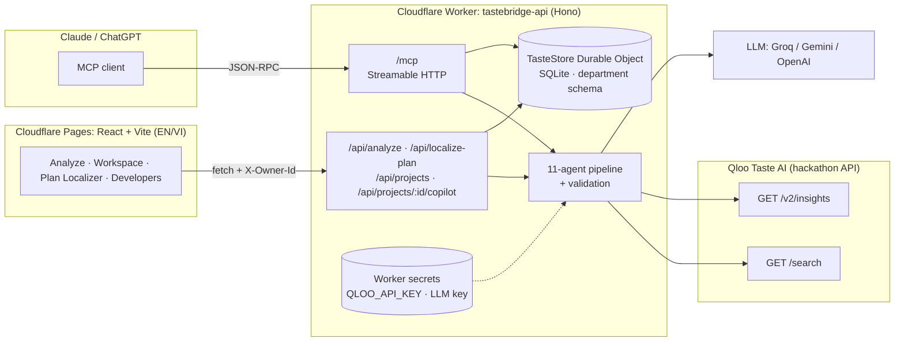
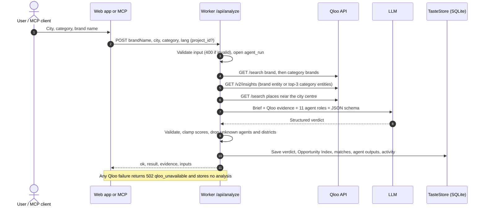

<div align="center">

# TasteBridge

### Will your brand land in Vietnam? Find out before you sign the lease.

**TasteBridge is an AI market-entry analyst for foreign consumer brands entering Vietnam.**
Eleven specialist agents reason over **Qloo Taste AI** evidence and return a **GO / PILOT / NO-GO** verdict, with confidence, affinity scores, audience segments, competitors, risks, launch partners, a neighborhood heat map and a market-entry memo, in English or Vietnamese.

[](LICENSE)
[](https://www.qloo.com/)
[](https://react.dev/)
[](https://vite.dev/)
[](https://workers.cloudflare.com/)
[](https://hono.dev/)
[](docs/MCP.md)
[](#)
[](https://github.com/ducvuathuduc/tastebridge/actions/workflows/ci.yml)

**[Live demo](https://tastebridge.pages.dev)** · **[MCP server](docs/MCP.md)** · **[Devpost](https://devpost.com/software/tastebridge-t2ygxn)** · **[Architecture](docs/ARCHITECTURE.md)** · **[Agents](docs/AGENTS.md)** · **[API](docs/API.md)** · **[Tiếng Việt](README.vi.md)**

*Entry for the Qloo Agentic Hackathon.*

</div>

---

## Contents

- [Screenshots](#screenshots)
- [The problem](#the-problem)
- [What TasteBridge does](#what-tastebridge-does)
- [The 11 agents](#the-11-agents)
- [Architecture](#architecture)
- [Qloo integration](#qloo-integration)
- [Data honesty policy](#data-honesty-policy)
- [Tech stack](#tech-stack)
- [Project structure](#project-structure)
- [Getting started](#getting-started)
- [Roadmap](#roadmap)
- [Business model](#business-model)
- [Team](#team)
- [License](#license)

## Screenshots

> These captures come from the v0.1 prototype (Oct 14, 2026). The live app at [tastebridge.pages.dev](https://tastebridge.pages.dev) runs the same analysis flow with a redesigned interface plus the Market-Entry OS.

| Landing | Agents at work |
|---|---|
|  |  |
| **Landing:** one question, one click to start an analysis. | **Agent run:** each specialist agent reports as the pipeline progresses. |

| Verdict and evidence | Opportunity index | Mobile |
|---|---|---|
|  |  |  |
| **Result:** verdict, affinity, neighborhood heat map, risks and the Qloo evidence behind them. | **Opportunity index:** one number per city, consistent with the verdict. | **Mobile:** the full flow works on a phone. |

## The problem

Foreign food, beverage and consumer brands look at Vietnam (100M people, a young urban middle class, fast-growing cafe and retail culture) and ask the same question: *will people here actually like us?*

Today the answer costs weeks of consultant time and a five-figure invoice, or it is a guess made after a lease is signed. The data that matters most, **what local consumers' tastes connect to**, is rarely in a market report. Brands that guess wrong pay for it with a closed store in year one.

## What TasteBridge does

TasteBridge turns that question into a structured, evidence-backed decision in about a minute, and then helps the brand act on it.

### 1. Analysis (live)
Pick a city (Ho Chi Minh City, Hanoi, Da Nang) and a category (F&B, coffee & tea, fashion, beauty, electronics, wellness, home & living), type the brand name. The backend pulls taste evidence from Qloo, then runs eleven specialist agents over it.

### 2. Verdict (live)
A **GO / PILOT / NO-GO** call with confidence (0–100), an opportunity index, affinity scores (overall, cultural, audience, competition, price), top consumer segments, named competitors with threat level, risks with mitigations, launch channels, partner suggestions, a first-store score for every district on a map, and a market-entry memo you can copy, download or print. Every result shows the Qloo evidence it was grounded in.

### 3. Market-Entry OS (live)
A verdict is where the work starts. The Market-Entry OS turns a GO or PILOT into an executed launch:

| Module | What it does | Status |
|---|---|---|
| **Brand Workspace** (`/workspace`) | One workspace per brand and market: verdict history, roadmap, documents, partners, sites, KPIs, activity log. Per-browser demo account, no paid auth. | Live |
| **Roadmap: Discover → Validate → Setup → Launch → Scale** | Kanban seeded with an auto-generated Vietnam playbook: trademark at IP Vietnam, investment/enterprise registration, FDI retail licence, food-safety certificate, import declarations and Vietnamese labels, lease, soft opening, KOL/TikTok, GrabFood/ShopeeFood/Zalo OA, second city. | Live |
| **Compliance docs** | Licences, certificates and leases with expiry warnings (expired / ≤30 days). | Live |
| **Partner pipeline** | Agent-ranked matches + directory → intro → term sheet → signed. | Live |
| **Sites** | First-store shortlist built from the agent's district heat map. | Live |
| **KPIs** | Monthly KPI and budget charts. | Live |
| **Entry Copilot** | LLM assistant that sees the project's roadmap, documents, deals and latest verdict. | Live |
| **Plan Localizer** (`/localize`) | Paste or upload (PDF/TXT) a business plan; agents return VND pricing, product/menu changes, channels, regulations and cultural risks with Qloo evidence. | Live |
| **API + MCP** (`/developers`) | REST API and a remote MCP server so Claude / ChatGPT can call TasteBridge. | Live |
| **Ecosystem marketplace** | Service providers, local operators and investors meet brands with a validated thesis. | Planned |

Seeded examples (the fictional *Harbor & Pine Coffee (DEMO)* project, directory operators, demo KPIs) carry a **DEMO DATA** badge.

## The 11 agents

All eleven run in one structured reasoning pass over the Qloo evidence; the Verdict Synthesizer weighs the other ten. Full spec: [docs/AGENTS.md](docs/AGENTS.md).

| # | Agent | Question it answers | Inputs | Output |
|---|---|---|---|---|
| 01 | **Brand Profiler** | How will Vietnamese consumers read this brand's positioning, price tier and cultural signals? | Brand name, category, Qloo brand match and taste tags | Summary + 2 findings |
| 02 | **Audience Mapper** | Which Vietnamese segments are most likely to engage, and why? | Brand profile, Qloo tags and related brands | Summary, findings, up to 5 segments with appeal 0–100 |
| 03 | **City Scout** | Where do demand and retail gravity sit in the target city for this category? | City, category, Qloo popular places in the city | Summary + findings |
| 04 | **Taste Affinity** | How strong is the measured taste match? | Qloo related brands with affinity (0–1), tags | Affinity scores: overall, cultural, audience, competition, price (0–100) |
| 05 | **Competitor Scan** | Who is already in market, and how threatening are they? | Qloo related brands, city places, market knowledge | Up to 6 competitors with positioning and threat (low/medium/high) |
| 06 | **Cultural Fit** | Does the brand fit local norms, gifting culture, family structure and social habits? | Brand profile, category, city | Summary + findings |
| 07 | **Price Sensitivity** | What will people pay versus local incomes, and how much pricing headroom is there? | Price tier, category, city | Summary + findings |
| 08 | **Channel Planner** | Which 3–4 channels should the launch use? | City, category, segments | Up to 4 launch channels |
| 09 | **Risk Analyst** | What could go wrong, and how do we reduce it? | All upstream outputs | 3–5 risks with severity and mitigation |
| 10 | **Localization Writer** | What one line would land with Vietnamese consumers? | Brand profile, segments, language | Positioning line in the summary |
| 11 | **Verdict Synthesizer** | GO, PILOT or NO-GO, and how sure are we? | Every agent's output + evidence quality | Verdict, confidence, opportunity index, headline, rationale, memo intro |

The same pass also produces 3–4 launch partners (name, role, fit 0–100) and a 0–100 first-store score for each district the client sends.

## Architecture



### One analysis run



Data model (departments, Mermaid ER diagram): [docs/DATA_ARCHITECTURE.md](docs/DATA_ARCHITECTURE.md). More: [docs/ARCHITECTURE.md](docs/ARCHITECTURE.md).

## Qloo integration

Qloo is called **server-side only**, from `worker/src/qloo.ts`, against `https://hackathon.api.qloo.com` with the `X-Api-Key` header (15 s timeout per call). The key is a Cloudflare Worker secret and never reaches the browser.

| Step | Endpoint | Parameters | Used for |
|---|---|---|---|
| 1 | `GET /search` | `query=<brand name>`, `types=urn:entity:brand`, `take=5` | Resolve the brand to a Qloo entity (top hit), its popularity and taste tags |
| 2 | `GET /search` | `query=<category brand term>` (e.g. `specialty coffee`), `types=urn:entity:brand`, `take=5` | Category-level fallback signals (top 3) when the brand itself is unknown to Qloo |
| 3 | `GET /v2/insights` | `signal.interests.entities=<entity ids>`, `filter.type=urn:entity:brand`, `take=12` | Related brands with measured affinity (kept: top 8, affinity rounded to 2 dp) |
| 4 | `GET /search` | `query=<category place term>`, `types=urn:entity:place`, `filter.location=<lat,long>`, `filter.radius=10`, `take=10`, `sort_by=popularity` | Popular local places in the target city (top 8) |

City centres: HCMC `10.776,106.703`, Hanoi `21.028,105.852`, Da Nang `16.047,108.218`.
A `404` is treated as an honest empty result; any other error or timeout aborts the run. Full detail: [docs/QLOO_INTEGRATION.md](docs/QLOO_INTEGRATION.md).

## Data honesty policy

- **No invented data.** If Qloo is unreachable or returns nothing usable for the brand or category, the function returns `502 qloo_unavailable` and the UI shows an error. It never falls back to made-up evidence.
- **Evidence is shown.** Every result carries the evidence block (brand match, tags, related brands with affinity, city places) and the UI renders it next to the verdict.
- **Confidence follows evidence.** When Qloo has no direct entity for the brand, the prompt caps confidence below 70 and says category-level signals were used.
- **The model is told not to fabricate** statistics, market-share numbers or ratings; scores are clamped to 0–100 and enums are enforced server-side.
- **Illustrative content is labelled.** The Partners page (directory, match flow, pipeline board) carries a **DEMO DATA** badge, the Outcome Data Vault rows carry a **SAMPLE** badge, the landing-page product demo says it is simulated, and the Pricing page states payments are not enabled.
- **Advisory, not a guarantee.** A verdict is decision support for a human team.

## Tech stack

| Layer | Technology |
|---|---|
| Frontend | React 18, Vite 8, React Router 6, Tailwind CSS 3, shadcn/ui (Radix), Framer Motion, Recharts, React Leaflet — hosted on Cloudflare Pages |
| API | Cloudflare Workers + Hono (TypeScript) |
| MCP | Remote MCP server on the same Worker (`/mcp`, Streamable HTTP) |
| Data | SQLite-backed Durable Object (`TasteStore`) with a department schema; D1-compatible |
| AI | Groq (Llama 3.3 70B) / Gemini / OpenAI via Worker secrets, strict JSON schema + server-side validation |
| Taste data | Qloo Taste AI: `/search`, `/v2/insights` |
| i18n | In-house EN/VI dictionary (`src/lib/i18n.jsx`, `src/lib/i18n-os.js`) |
| Tests / CI | Vitest (Qloo and LLM mocked, store on node:sqlite); GitHub Actions builds web + worker |

## Project structure

```
tastebridge/
├── worker/                              # Cloudflare Worker API + MCP (Hono, TypeScript)
│   ├── src/index.ts                     # Routes
│   ├── src/analyze.ts  qloo.ts  llm.ts  # Qloo evidence + 11-agent pipeline + validation
│   ├── src/localize.ts                  # Plan Localizer
│   ├── src/mcp.ts                       # MCP server (Streamable HTTP)
│   ├── src/db.ts  store.ts  playbook.ts # Department data model, Durable Object SQLite store, Vietnam playbook
│   ├── migrations/0001_init.sql         # Schema (source of truth)
│   └── test/                            # Vitest
├── src/
│   ├── api/client.js                    # API client (X-Owner-Id per browser)
│   ├── pages/                           # Landing, Analyze, Workspace, PlanLocalizer, Developers, Markets, Platform, Partners, Pricing, Investors, About
│   ├── components/
│   │   ├── analyze/  workspace/         # Wizard, verdict, heat map, memo · workspace tabs + Entry Copilot
│   │   ├── landing/ markets/ partners/ platform/ investors/
│   │   └── ui/                          # shadcn/ui primitives
│   └── lib/                             # agents, cities/districts, i18n (EN/VI), local demo account
├── docs/                                # DATA_ARCHITECTURE, MCP, ARCHITECTURE, AGENTS, API, QLOO_INTEGRATION, ROADMAP …
├── scripts/                             # Pages fallback deploy
└── .github/workflows/                   # ci.yml (web + worker), deploy.yml
```

## Getting started

**Prerequisites:** Node.js 22+ and npm. A Qloo API key and one LLM key (Groq, Gemini or OpenAI) to run the backend.

```bash
git clone https://github.com/ducvuathuduc/tastebridge.git
cd tastebridge
npm install
npm run dev                          # web on http://localhost:5173 (talks to http://localhost:8787)

cd worker
npm install
printf 'QLOO_API_KEY=...\nGROQ_API_KEY=...\n' > .dev.vars   # git-ignored
npx wrangler dev                     # API + MCP on http://localhost:8787
npm test
```

**Deploy:**

```bash
cd worker
npx wrangler secret put QLOO_API_KEY
npx wrangler secret put GROQ_API_KEY       # or GEMINI_API_KEY / OPENAI_API_KEY
npx wrangler deploy
cd ..
VITE_API_BASE=https://<your-worker>.workers.dev npm run build
npx --prefix worker wrangler pages deploy dist --project-name tastebridge
```

Secrets are never written to the repo. See [worker/README.md](worker/README.md) and [docs/MCP.md](docs/MCP.md).

## Roadmap

| Horizon | Milestone |
|---|---|
| Now | Vietnam pack live: HCMC, Hanoi, Da Nang · 7 categories · 11 agents · EN/VI |
| Now | Market-Entry OS v1: Brand Workspace, playbook, compliance tracker, partner pipeline, sites, KPIs, Entry Copilot, Plan Localizer, API + MCP |
| Then | Market Packs for **Thailand, Malaysia, Indonesia, Philippines** |
| Platform | Agent Registry (Supplier Match, Legal Analyst, Hiring Planner), public API, white-label for trade agencies, banks and funds |

Full roadmap: [docs/ROADMAP.md](docs/ROADMAP.md).

## Business model

"Start free. Pay when it works." The planned model, as shown on the app's Pricing page (**payments are not enabled yet**):

| Tier | Planned price | Includes |
|---|---|---|
| Free scan | $0 | 1 analysis per month, one Vietnamese city at a time, memo export and share |
| Pro | $149 / month | Unlimited analyses, all 3 cities, partner match and deal pipeline, API access |
| Enterprise | Custom | White-label and multi-tenant, first access to new Market Packs, Outcome Data Vault, dedicated support |
| Success fee | Per deal | Launch on a GO verdict and a small share of first-year Vietnam revenue is due; no launch, no fee |

On top of this, the Market-Entry OS adds a marketplace take rate on deals between brands, service providers and operators. See [docs/BUSINESS_ARCHITECTURE.md](docs/BUSINESS_ARCHITECTURE.md).

## Team

**Huỳnh Diệu Thành** (Thanh Huynh Dieu): founder and engineer, [VTech Studio](https://vtechstudio.tech). Software engineering student at FPT University, Ho Chi Minh City.
[LinkedIn](https://www.linkedin.com/in/thanh-huynh-ai)

## License

[MIT](LICENSE) © 2026 Huỳnh Diệu Thành (VTech Studio).

Qloo is a trademark of Qloo, Inc. TasteBridge is an independent hackathon project and is not affiliated with or endorsed by Qloo.
