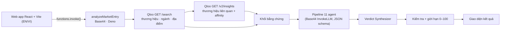

<div align="center">

# TasteBridge

### Thương hiệu của bạn có "hợp gu" người Việt? Biết trước khi ký hợp đồng thuê mặt bằng.

**TasteBridge là chuyên viên phân tích gia nhập thị trường bằng AI cho các thương hiệu tiêu dùng nước ngoài vào Việt Nam.**
Mười một agent chuyên biệt suy luận trên dữ liệu **Qloo Taste AI** và trả về kết luận **GO / PILOT / NO-GO**, kèm độ tin cậy, điểm hợp gu, phân khúc khách hàng, đối thủ, rủi ro, đối tác ra mắt, bản đồ nhiệt theo quận và bản ghi nhớ gia nhập thị trường, bằng tiếng Anh hoặc tiếng Việt.

[](LICENSE)
[](https://www.qloo.com/)
[](https://react.dev/)
[](https://vite.dev/)
[](https://base44.com/)
[](https://deno.com/)
[](#)
[](https://github.com/ducvuathuduc/tastebridge/actions/workflows/ci.yml)

**[Bản demo trực tuyến](https://taste-bridge-vietnam.base44.app)** · **[Devpost](https://devpost.com/software/tastebridge-t2ygxn)** · **[Kiến trúc](docs/ARCHITECTURE.md)** · **[Agents](docs/AGENTS.md)** · **[API](docs/API.md)** · **[English](README.md)**

*Bài dự thi Qloo Agentic Hackathon.*

</div>

---

## Ảnh chụp màn hình

> Các ảnh dưới đây chụp từ bản prototype v0.1 (14/10/2026). Ứng dụng Base44 đang chạy tại [taste-bridge-vietnam.base44.app](https://taste-bridge-vietnam.base44.app) dùng cùng luồng phân tích với giao diện đã thiết kế lại.

| Trang chủ | Các agent đang chạy |
|---|---|
|  |  |
| **Trang chủ:** một câu hỏi, một cú nhấp để bắt đầu phân tích. | **Agent:** từng agent báo cáo khi pipeline chạy. |

| Kết luận và bằng chứng | Chỉ số cơ hội | Di động |
|---|---|---|
|  |  |  |
| **Kết quả:** kết luận, điểm hợp gu, bản đồ nhiệt, rủi ro và bằng chứng Qloo. | **Chỉ số cơ hội:** một con số cho mỗi thành phố, nhất quán với kết luận. | **Di động:** toàn bộ luồng chạy được trên điện thoại. |

## Vấn đề

Các thương hiệu ăn uống và tiêu dùng nước ngoài nhìn vào Việt Nam (100 triệu dân, tầng lớp trung lưu đô thị trẻ, văn hóa cà phê và bán lẻ phát triển nhanh) và cùng hỏi: *người ở đây có thật sự thích mình không?*

Hiện nay câu trả lời tốn vài tuần thuê tư vấn và hóa đơn hàng chục nghìn đô, hoặc là một phỏng đoán sau khi đã ký mặt bằng. Dữ liệu quan trọng nhất, **gu của người tiêu dùng địa phương gắn với những gì**, hiếm khi có trong báo cáo thị trường. Đoán sai thì trả giá bằng một cửa hàng đóng cửa ngay năm đầu.

## TasteBridge làm gì

### 1. Phân tích (đang chạy)
Chọn thành phố (TP.HCM, Hà Nội, Đà Nẵng) và ngành hàng (ăn uống, cà phê & trà, thời trang, làm đẹp, điện tử, sức khỏe, nhà cửa), nhập tên thương hiệu. Backend lấy bằng chứng từ Qloo rồi chạy 11 agent trên đó.

### 2. Kết luận (đang chạy)
Kết luận **GO / PILOT / NO-GO** với độ tin cậy (0–100), chỉ số cơ hội, điểm hợp gu (tổng, văn hóa, khách hàng, cạnh tranh, giá), phân khúc chính, đối thủ kèm mức đe dọa, rủi ro kèm biện pháp, kênh ra mắt, gợi ý đối tác, điểm mở cửa hàng đầu tiên cho từng quận trên bản đồ, và bản ghi nhớ có thể sao chép, tải về hoặc in. Mọi kết quả đều hiển thị bằng chứng Qloo làm nền.

### 3. Market-Entry OS *(đang triển khai)*
Kết luận chỉ là điểm khởi đầu. Market-Entry OS đang được xây dựng để biến GO hoặc PILOT thành một lần ra mắt thực sự:

| Mô-đun | Chức năng | Trạng thái |
|---|---|---|
| **Brand Workspace** | Không gian làm việc cho mỗi thương hiệu và thị trường, lưu mọi phân tích, quyết định và tài liệu. | Đang triển khai |
| **Playbook: Discover → Validate → Setup → Launch → Scale** | Kế hoạch gia nhập theo giai đoạn, có đầu việc, người phụ trách và cổng kiểm soát. | Đang triển khai |
| **Theo dõi hồ sơ pháp lý** | Theo dõi giấy phép, đăng ký và hồ sơ cần cho việc ra mắt cùng trạng thái từng loại. | Đang triển khai |
| **Pipeline đối tác** | Bảng kanban nhà phân phối, chủ mặt bằng, agency và nhà vận hành, từ liên hệ đầu đến ký kết. | Đang triển khai |
| **Địa điểm** | Mặt bằng ứng viên được chấm điểm theo bản đồ nhiệt quận. | Đang triển khai |
| **KPI** | Chỉ số ra mắt và sau khai trương do thương hiệu định nghĩa và theo dõi. | Đang triển khai |
| **Entry Copilot** | Agent soạn thảo, đôn đốc và tóm tắt công việc trong playbook. | Đang triển khai |
| **Marketplace hệ sinh thái** | Nhà cung cấp dịch vụ, nhà vận hành địa phương và nhà đầu tư gặp các thương hiệu đã có luận điểm được kiểm chứng. | Đang triển khai |

Ứng dụng hiện có các trang Markets, Platform (Market Packs, Agent Registry, API), Partners và Investors; nội dung đối tác và pipeline ở đó được gắn nhãn **DEMO DATA** cho đến khi có đối tác thật.

## 11 agent

Cả 11 agent chạy trong một lượt suy luận có cấu trúc trên bằng chứng Qloo; Verdict Synthesizer tổng hợp 10 agent còn lại. Chi tiết: [docs/AGENTS.md](docs/AGENTS.md).

| # | Agent | Câu hỏi trả lời | Đầu vào | Đầu ra |
|---|---|---|---|---|
| 01 | **Hồ sơ thương hiệu** (Brand Profiler) | Người Việt sẽ đọc định vị, phân khúc giá, tín hiệu văn hóa của thương hiệu thế nào? | Tên, ngành hàng, thực thể Qloo và taste tags | Tóm tắt + 2 phát hiện |
| 02 | **Định vị khách hàng** (Audience Mapper) | Nhóm khách hàng Việt nào dễ quan tâm nhất, vì sao? | Hồ sơ thương hiệu, tags, thương hiệu liên quan | Tối đa 5 phân khúc, mức hấp dẫn 0–100 |
| 03 | **Trinh sát thành phố** (City Scout) | Nhu cầu và lực hút bán lẻ của ngành hàng nằm ở đâu trong thành phố? | Thành phố, ngành hàng, địa điểm phổ biến từ Qloo | Tóm tắt + phát hiện |
| 04 | **Đo độ hợp gu** (Taste Affinity) | Mức hợp gu đo được mạnh đến đâu? | Thương hiệu liên quan kèm affinity Qloo (0–1) | Điểm tổng, văn hóa, khách hàng, cạnh tranh, giá (0–100) |
| 05 | **Quét đối thủ** (Competitor Scan) | Ai đã có mặt, mức đe dọa ra sao? | Thương hiệu liên quan, địa điểm thành phố | Tối đa 6 đối thủ, định vị và mức đe dọa |
| 06 | **Độ phù hợp văn hóa** (Cultural Fit) | Có hợp chuẩn mực, văn hóa quà tặng, gia đình, mạng xã hội? | Hồ sơ thương hiệu, ngành, thành phố | Tóm tắt + phát hiện |
| 07 | **Độ nhạy giá** (Price Sensitivity) | Người dùng sẵn lòng trả bao nhiêu so với thu nhập, dư địa giá? | Phân khúc giá, ngành, thành phố | Tóm tắt + phát hiện |
| 08 | **Lập kế hoạch kênh** (Channel Planner) | Nên ra mắt qua 3–4 kênh nào? | Thành phố, ngành, phân khúc | Tối đa 4 kênh |
| 09 | **Phân tích rủi ro** (Risk Analyst) | Điều gì có thể sai, giảm thiểu thế nào? | Mọi đầu ra phía trước | 3–5 rủi ro, mức độ, biện pháp |
| 10 | **Chấp bút bản địa hóa** (Localization Writer) | Câu định vị nào sẽ chạm người Việt? | Hồ sơ, phân khúc, ngôn ngữ | Câu định vị |
| 11 | **Tổng hợp kết luận** (Verdict Synthesizer) | GO, PILOT hay NO-GO, chắc chắn đến đâu? | Đầu ra của mọi agent + chất lượng bằng chứng | Kết luận, độ tin cậy, chỉ số cơ hội, tiêu đề, lập luận, mở đầu memo |

## Kiến trúc



Sơ đồ tuần tự đầy đủ của một lượt phân tích: xem [README.md](README.md#one-analysis-run) và [docs/ARCHITECTURE.md](docs/ARCHITECTURE.md).

## Tích hợp Qloo

Qloo chỉ được gọi **phía máy chủ** từ `base44/functions/analyzeMarketEntry/entry.ts`, tới `https://hackathon.api.qloo.com` với header `X-Api-Key` (timeout 15 giây mỗi lệnh gọi). Khóa nằm trong Base44 secrets, không bao giờ xuống trình duyệt.

| Bước | Endpoint | Tham số | Mục đích |
|---|---|---|---|
| 1 | `GET /search` | `query=<tên thương hiệu>`, `types=urn:entity:brand`, `take=5` | Xác định thực thể Qloo của thương hiệu, độ phổ biến và tags |
| 2 | `GET /search` | `query=<từ khóa ngành>`, `types=urn:entity:brand`, `take=5` | Tín hiệu dự phòng cấp ngành (top 3) khi Qloo không biết thương hiệu |
| 3 | `GET /v2/insights` | `signal.interests.entities=<ids>`, `filter.type=urn:entity:brand`, `take=12` | Thương hiệu liên quan kèm affinity đo được (giữ top 8) |
| 4 | `GET /search` | `query=<loại địa điểm>`, `types=urn:entity:place`, `filter.location=<lat,long>`, `filter.radius=10`, `take=10`, `sort_by=popularity` | Địa điểm phổ biến trong thành phố (top 8) |

## Chính sách trung thực dữ liệu

- **Không bịa dữ liệu.** Nếu Qloo lỗi hoặc không có dữ liệu cho thương hiệu và ngành, hàm trả `502 qloo_unavailable` và giao diện báo lỗi, không bao giờ dùng bằng chứng giả.
- **Bằng chứng được hiển thị** cạnh mọi kết luận.
- **Độ tin cậy theo bằng chứng:** khi Qloo không có thực thể trực tiếp, độ tin cậy giữ dưới 70.
- **Mô hình bị cấm bịa** số liệu thống kê, thị phần hay xếp hạng; điểm được giới hạn 0–100 phía máy chủ.
- **Nội dung minh họa được gắn nhãn:** trang Partners có nhãn DEMO DATA, bảng Outcome Data Vault có nhãn SAMPLE, demo trang chủ ghi rõ là mô phỏng, trang Pricing ghi rõ chưa bật thanh toán.
- **Kết luận mang tính tư vấn**, không phải bảo đảm.

## Công nghệ

React 18 · Vite 8 · Tailwind CSS · shadcn/ui · React Leaflet · Recharts · TanStack Query · Base44 SDK · hàm serverless Deno · Base44 InvokeLLM · Qloo Taste AI · GitHub Actions.

## Bắt đầu

```bash
git clone https://github.com/ducvuathuduc/tastebridge.git
cd tastebridge
npm install
cp .env.example .env.local
npm run dev
```

Biến môi trường frontend: `VITE_BASE44_APP_ID`, `VITE_BASE44_APP_BASE_URL`, `VITE_BASE44_FUNCTIONS_VERSION` (tùy chọn). Secret backend đặt trong Base44: `QLOO_API_KEY`.
Triển khai: `npx base44 login && npx base44 link && npx base44 deploy`.

## Lộ trình

Việt Nam (đang chạy) → Market-Entry OS → Thái Lan, Malaysia, Indonesia, Philippines → Agent Registry, API công khai, white-label. Chi tiết: [docs/ROADMAP.md](docs/ROADMAP.md).

## Mô hình kinh doanh

"Bắt đầu miễn phí. Trả tiền khi hiệu quả." Mô hình dự kiến theo trang Pricing (**chưa bật thanh toán**): Free scan $0 (1 lượt/tháng); Pro $149/tháng (không giới hạn phân tích, cả 3 thành phố, kết nối đối tác, API); Enterprise tùy chỉnh (white-label, Market Pack mới sớm nhất, Outcome Data Vault); phí thành công theo thương vụ (một phần nhỏ doanh thu năm đầu tại Việt Nam khi ra mắt theo kết luận GO, không ra mắt thì không thu). Market-Entry OS bổ sung phí giao dịch trên marketplace. Xem [docs/BUSINESS_ARCHITECTURE.vi.md](docs/BUSINESS_ARCHITECTURE.vi.md).

## Đội ngũ

**Huỳnh Diệu Thành**: nhà sáng lập và kỹ sư, [VTech Studio](https://vtechstudio.tech); sinh viên Kỹ thuật phần mềm, Đại học FPT TP.HCM. [LinkedIn](https://www.linkedin.com/in/thanh-huynh-ai)

## Giấy phép

[MIT](LICENSE) © 2026 Huỳnh Diệu Thành (VTech Studio). Qloo là thương hiệu của Qloo, Inc.; TasteBridge là dự án hackathon độc lập, không liên kết với Qloo.
