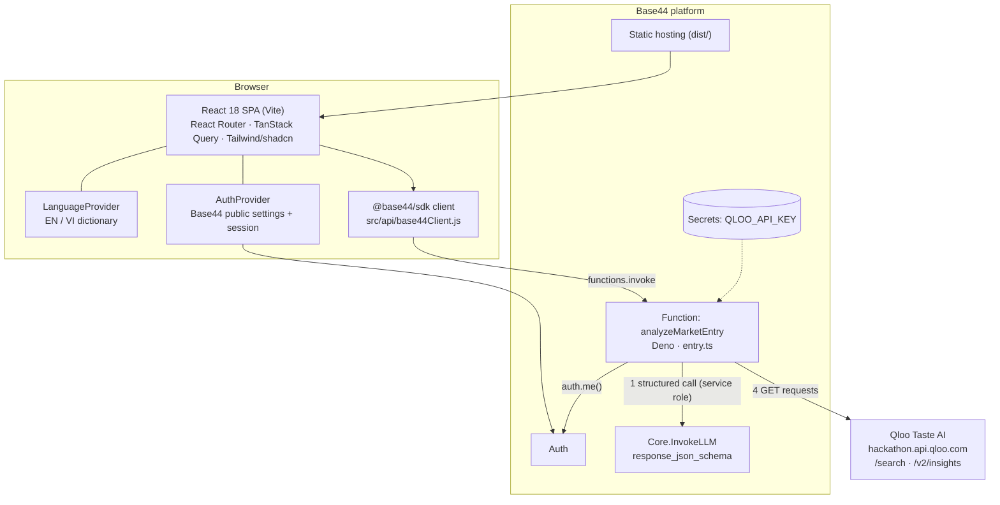
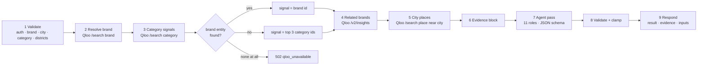

# Architecture

This document describes how TasteBridge works today (v0.2.0), read from the source. Planned components are marked as such.

## 1. System overview

| Concern | Where | Notes |
|---|---|---|
| UI and routing | `src/App.jsx`, `src/pages/*` | Routes: `/`, `/analyze`, `/markets`, `/platform`, `/partners`, `/pricing`, `/investors`, `/about`, plus auth pages |
| Language | `src/lib/i18n.jsx` | Every visible string has EN and VI; the chosen language is also sent to the backend so agent output is written in it |
| Auth | `src/lib/AuthContext.jsx` | Loads Base44 public settings, checks the session token, redirects to login when the app requires it |
| Static reference data | `src/lib/analyzeData.js`, `agentsData.js` | Cities, categories, districts with coordinates, agent names and roles |
| Analysis backend | `base44/functions/analyzeMarketEntry/entry.ts` | The only server code: input validation, Qloo calls, prompt, LLM call, output validation |
| Secrets | Base44 secrets | `QLOO_API_KEY`; nothing secret in the repo or client bundle |

## 2. The analysis pipeline

### Step by step

1. **Validate.** `base44.auth.me()` must return a user (`401` otherwise). `brandName` is trimmed to 80 chars; `city` must be `hcmc | hanoi | danang`; `category` one of 7 ids; `neighborhoods` is a list of 1–60 char strings, capped at 15. `lang` is `vi` or `en`.
2. **Resolve the brand** with `GET /search` (`types=urn:entity:brand`, `take=5`). The first hit is the brand entity.
3. **Category signals** with a second `GET /search` using the category's brand term (e.g. `specialty coffee`); top 3 kept.
4. **Related brands** with `GET /v2/insights` (`signal.interests.entities` = the brand id, or the category ids if the brand is unknown; `filter.type=urn:entity:brand`; `take=12`). Top 8 names with `affinity` rounded to 2 dp.
5. **City places** with `GET /search` (`types=urn:entity:place`, `filter.location=<city centre>`, `filter.radius=10`, `sort_by=popularity`, `take=10`). Top 8 names.
6. **Evidence block.** Brand match and popularity (or an explicit "no entity, category signals used" line), up to 14 taste tags, related brands with affinity, and city places. Missing pieces are written as `none available`, never filled in.
7. **Agent pass.** One prompt defines the brief, the evidence, the 11 agent roles in order, verdict rules, opportunity-index rules, partner rules, the district list and output rules. It is sent to Base44 `Core.InvokeLLM` with a strict JSON schema (see [API.md](API.md)), through the service role so the call runs under the app rather than the end user.
8. **Validate and clamp.** Verdict must be one of the three values; scores are clamped to 0–100 integers; threat/severity forced to `low | medium | high`; unknown agent ids and districts not in the request are dropped; list sizes and string lengths are capped. No valid verdict or no agent outputs → `502`.
9. **Respond** with `{ ok, result, evidence, inputs }`.

Qloo failures at any step (network, timeout, non-404 error) throw a `QlooError` and the whole run returns `502 qloo_unavailable`. A `404` from Qloo is treated as an empty result.

### Why one structured pass

The eleven agents are distinct roles with distinct output contracts, but they are executed in **one** schema-constrained LLM call rather than eleven sequential calls. That keeps an analysis to a single round-trip (fast enough for a live demo), guarantees every agent sees the same evidence, and lets the Verdict Synthesizer weigh all other outputs in context. The Agent Registry on the roadmap moves to per-agent calls with their own tools where a role needs it (for example a Legal Analyst that reads regulations).

## 3. Frontend flow

The Analyze page (`src/pages/Analyze.jsx`) is a six-step flow shown in a stepper:

| Step | View | Component(s) |
|---|---|---|
| 1 Market & city | Choose city and category | `MarketCityStep` |
| 2 Brand | Enter brand name | `BrandStep` |
| 3 Agent run | Timeline of the 11 agents | `AgentTimeline` |
| 4 Verdict | Verdict header, affinity, segments, district heat map | `VerdictHeader`, `AffinityCard`, `SegmentsCard`, `NeighborhoodMap` (Leaflet) |
| 5 Partner match | Partners, competitors, risks, channels, Qloo evidence | `PartnersCard`, `CompetitorsCard`, `RisksCard`, `ChannelsCard`, `EvidenceCard` |
| 6 Memo | Market-entry memo: copy, download, print / save PDF | `MemoPanel` |

Notes:

- The client sends the district names for the chosen city from `analyzeData.js`; the map plots the scores returned for those names at their stored coordinates.
- During step 3 the timeline advances on a 1.6 s timer while the single backend call is in flight; agent summaries are filled from the response when it arrives. The timeline is a progress view, not a per-agent stream.
- `?sample=1` runs a preset analysis (Blue Bottle Coffee · HCMC · Coffee & Tea); `?city=` preselects a city.
- Errors with `code: "qloo_unavailable"` show a dedicated message; others a generic one. Both offer retry.

## 4. Other pages

| Page | Content | Data |
|---|---|---|
| Landing | Hero, self-running product demo (labelled simulated), agents grid, how-it-works diagram, flywheel | Static |
| Markets | Market switcher and leaderboard; Vietnam live, four SEA markets on the roadmap | `marketsData.js` |
| Platform | Market Packs, Agent Registry (11 active + 3 upcoming), API preview, white-label, Outcome Data Vault | `platformData.js`; vault rows carry a **Sample** badge |
| Partners | Directory, match flow, pipeline board (session-only state) | `partnersData.js`; page carries a **Demo data** badge |
| Pricing | Free / Pro / Enterprise tiers and success fee | Planned model; page states payments are not enabled |
| Investors | Problem/solution, why now, moat, growth doors, roadmap | Static; page states it is illustrative |
| About | How Qloo is used, limitations | Static |

## 5. Security and privacy

- Qloo key only in Base44 secrets, read server-side with `secrets.get('QLOO_API_KEY')`.
- `.env*` files are git-ignored; `.env.example` contains placeholders only.
- The function requires an authenticated user, validates and bounds all input, and truncates all output.
- The LLM prompt contains only the brand name, category, city, district names and Qloo evidence. No personal data is sent.
- See [SECURITY.md](../SECURITY.md) for reporting vulnerabilities.

## 6. Build and delivery

- `npm run build` (Vite) produces `dist/`; Base44 serves it (`base44/config.jsonc`: install `npm install`, build `npm run build`, output `./dist`).
- Without `VITE_BASE44_APP_ID` the build still succeeds (the Base44 plugin prints a warning); CI relies on this and uses a placeholder.
- GitHub Actions (`.github/workflows/ci.yml`) runs `npm ci`, `npm run lint` and `npm run build` on Node 20 for every push and pull request to `main`.
- Deploys go through the Base44 CLI (`base44 deploy`).

## 7. Planned architecture (rolling out)

| Component | Purpose |
|---|---|
| Brand Workspace data model | Brands, markets, analyses, playbook stages, documents, partners, sites and KPIs as Base44 entities |
| Entry Copilot | Agents acting inside the playbook (drafting, reminders, summaries) |
| Market Packs | Per-country config: Qloo query terms, cities and districts, locale and currency, partner roles, regulatory notes |
| Agent Registry | Pluggable agents with their own prompt, tools and output contract |
| Public API | Versioned REST endpoints over the analysis and workspace |
| Outcome store | Records what happened after each verdict so predictions can be compared with outcomes |
