# TasteBridge data architecture

TasteBridge v1 stores every market entry as a **Brand Project** and organises the data around it the way a real
market-entry company is organised: by department. Each department owns its tables; agents write to an audit log so
every verdict can be traced back to the run, the model and the Qloo evidence that produced it.

- **Schema source of truth:** [`worker/migrations/0001_init.sql`](../worker/migrations/0001_init.sql)
  (compiled into `worker/src/schema.ts` by `npm run schema`).
- **Engine:** SQLite. In production it runs inside a SQLite-backed Cloudflare **Durable Object** (`TasteStore`,
  binding `STORE`), which gives transactions and a relational schema with no extra paid product. The same schema
  can run on **Cloudflare D1** — bind it as `DB` and run `wrangler d1 migrations apply tastebridge`; `worker/src/store.ts`
  exposes one D1-style interface for both.
- **Access:** only through the Worker API (`/api/...`) and the MCP server (`/mcp`). The browser never talks to the
  database or to Qloo directly; API keys live in Worker secrets.

## Departments

| Department | Tables | What lives there |
|---|---|---|
| **Strategy** | `brand_projects`, `verdicts`, `opportunity_index`, `milestones` | The project, each GO / PILOT / NO-GO verdict with its full agent output and Qloo evidence, the Opportunity Index time series, and the roadmap (Discover → Validate → Setup → Launch → Scale) |
| **Legal & Compliance** | `documents`, `licenses`, `trademarks` | Certificates and leases with expiry dates (the UI warns at ≤30 days), licence applications, trademark filings at IP Vietnam |
| **Real Estate** | `sites` | First-store candidates, seeded from the agent district heat map with their score |
| **Partnerships** | `partners`, `matches`, `deals` | Partner directory (operators, franchisees, delivery apps, e-commerce, CRM), agent-ranked matches per project, and the deal pipeline (intro → term sheet → signed / lost) |
| **Marketing** | `channels`, `campaigns`, `kols` | GrabFood / ShopeeFood / TikTok Shop / Zalo OA channels, campaigns and KOL prospects |
| **Operations / Supply** | `suppliers`, `import_items` | Importers, local roasters, logistics; imported SKUs with HS codes and permit requirements |
| **Finance** | `budgets`, `kpis` | Monthly budget vs actual per department (VND) and monthly KPIs with targets |
| **Agents** | `agent_runs`, `agent_outputs`, `activity` | One row per agent run (analyze / localize / copilot) with provider, model, status and error; one row per agent output; a human-readable activity log for every user and agent action |

## ER diagram

```mermaid
erDiagram
    BRAND_PROJECTS ||--o{ VERDICTS : "has"
    BRAND_PROJECTS ||--o{ OPPORTUNITY_INDEX : "tracks"
    VERDICTS ||--o| OPPORTUNITY_INDEX : "produces"
    BRAND_PROJECTS ||--o{ MILESTONES : "roadmap"

    BRAND_PROJECTS ||--o{ DOCUMENTS : "legal"
    BRAND_PROJECTS ||--o{ LICENSES : "legal"
    DOCUMENTS ||--o| LICENSES : "evidences"
    BRAND_PROJECTS ||--o{ TRADEMARKS : "legal"

    BRAND_PROJECTS ||--o{ SITES : "real estate"

    PARTNERS ||--o{ MATCHES : "matched in"
    PARTNERS ||--o{ DEALS : "negotiates"
    BRAND_PROJECTS ||--o{ MATCHES : "partnerships"
    BRAND_PROJECTS ||--o{ DEALS : "partnerships"

    BRAND_PROJECTS ||--o{ CHANNELS : "marketing"
    CHANNELS ||--o{ CAMPAIGNS : "runs"
    BRAND_PROJECTS ||--o{ CAMPAIGNS : "marketing"
    CAMPAIGNS ||--o{ KOLS : "books"
    BRAND_PROJECTS ||--o{ KOLS : "marketing"

    BRAND_PROJECTS ||--o{ SUPPLIERS : "operations"
    SUPPLIERS ||--o{ IMPORT_ITEMS : "supplies"
    BRAND_PROJECTS ||--o{ IMPORT_ITEMS : "operations"

    BRAND_PROJECTS ||--o{ BUDGETS : "finance"
    BRAND_PROJECTS ||--o{ KPIS : "finance"

    BRAND_PROJECTS ||--o{ AGENT_RUNS : "agents"
    AGENT_RUNS ||--o{ AGENT_OUTPUTS : "emits"
    AGENT_RUNS ||--o| VERDICTS : "results in"
    BRAND_PROJECTS ||--o{ ACTIVITY : "audit"

    BRAND_PROJECTS {
        text id PK
        text owner_id "per-browser demo account"
        text brand
        text city "hcmc | hanoi | danang"
        text category
        text stage "discover..scale"
        int is_demo
    }
    VERDICTS {
        text id PK
        text project_id FK
        text agent_run_id
        text verdict "GO | PILOT | NO-GO"
        int confidence
        int opportunity_index
        text result_json "11 agent outputs"
        text evidence_json "Qloo evidence"
    }
    OPPORTUNITY_INDEX {
        text id PK
        text project_id FK
        text verdict_id FK
        int value
        text as_of
    }
    MILESTONES {
        text id PK
        text project_id FK
        text phase
        text department
        text title
        text authority
        text status "todo | doing | done"
        text due_date
    }
    DOCUMENTS {
        text id PK
        text project_id FK
        text kind
        text title
        text issuer
        text expires_at
        text status
    }
    LICENSES {
        text id PK
        text project_id FK
        text document_id FK
        text license_type
        text authority
        text status
    }
    TRADEMARKS {
        text id PK
        text project_id FK
        text mark
        text nice_classes
        text office "IP Vietnam"
        text status
    }
    SITES {
        text id PK
        text project_id FK
        text district
        real lat
        real lng
        int score "agent heat map"
        int rent_vnd_month
        text status
    }
    PARTNERS {
        text id PK
        text name
        text type
        text cities
        int is_demo
    }
    MATCHES {
        text id PK
        text project_id FK
        text partner_id FK
        int fit
        text why
    }
    DEALS {
        text id PK
        text project_id FK
        text partner_id FK
        text stage "intro | termsheet | signed | lost"
        int value_vnd
    }
    CHANNELS {
        text id PK
        text project_id FK
        text name
        text kind
    }
    CAMPAIGNS {
        text id PK
        text project_id FK
        text channel_id FK
        int budget_vnd
    }
    KOLS {
        text id PK
        text project_id FK
        text campaign_id FK
        text handle
        text platform
    }
    SUPPLIERS {
        text id PK
        text project_id FK
        text name
        text kind
    }
    IMPORT_ITEMS {
        text id PK
        text project_id FK
        text supplier_id FK
        text sku
        text hs_code
        text permit_required
    }
    BUDGETS {
        text id PK
        text project_id FK
        text department
        text month
        int planned_vnd
        int actual_vnd
    }
    KPIS {
        text id PK
        text project_id FK
        text month
        text metric
        real value
        real target
    }
    AGENT_RUNS {
        text id PK
        text project_id FK
        text kind "analyze | localize | copilot"
        text provider
        text model
        text status
    }
    AGENT_OUTPUTS {
        text id PK
        text run_id FK
        text agent_id
        text summary
    }
    ACTIVITY {
        text id PK
        text project_id FK
        text actor "user | agent:x | system"
        text action
        text detail
    }
```

## Data rules

1. **Real Qloo only.** `verdicts.evidence_json` holds exactly what the Qloo Hackathon API returned (brand match, tags,
   related-brand affinities, city places). If Qloo fails, the API returns `502 qloo_unavailable` and nothing is stored.
2. **Demo data is labelled.** Seeded rows (the fictional "Harbor & Pine Coffee (DEMO)" project, partner directory
   operators, demo KPIs) carry `is_demo = 1`, `(DEMO)` in titles or `DEMO DATA` notes, and the UI shows a *Demo data*
   badge. Real platforms (GrabFood, ShopeeFood, TikTok Shop, Shopee, Zalo OA) are listed as channels, not as partners
   that have agreed to anything.
3. **Ownership.** v1 uses a per-browser demo account: the web app sends `X-Owner-Id`; projects are only listed and
   edited by that owner. MCP project tools address a project by its unguessable UUID.
4. **Audit.** Every analysis, localisation and copilot call creates an `agent_runs` row (status, provider, model,
   error), and every mutation writes to `activity`.
5. **Playbook.** New projects get a dated Vietnam playbook (`worker/src/playbook.ts`): trademark clearance and filing at
   IP Vietnam, investment/enterprise registration, FDI retail licence, food-safety certificate (F&B only), import
   declarations and Vietnamese labels, lease and fire safety, soft opening, KOL/TikTok seeding, GrabFood/ShopeeFood/Zalo
   OA, six-month KPI review and a second city. It is guidance, not legal advice.
